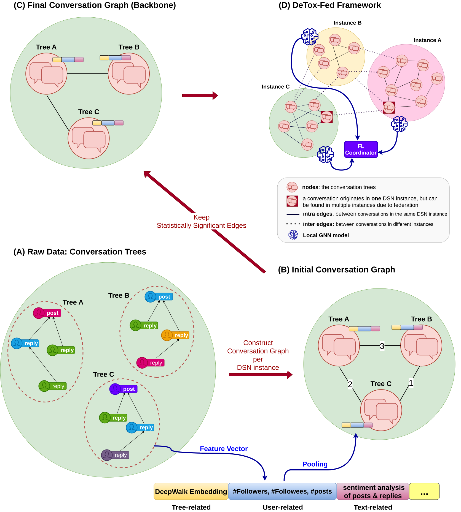

# DeTox-Fed

**Detecting Toxic Conversations in the Fediverse with Federated Graph Neural Networks**

[](https://arxiv.org/abs/2605.21054)

## Overview

Content moderation in the Fediverse is hard: conversations, users, and moderation decisions are spread across independently run instances. **DeTox-Fed** is a federated graph-learning framework for **conversation-level toxicity detection**. Instances train a shared moderation model together, while raw conversations and moderation labels stay local.

<p align="center">
  
</p>

<p align="center">
  <em>Overview of the DeTox-Fed framework.</em>
</p>

| Stage | What happens |
|---|---|
| **A. Raw conversations** | Conversation trees from each instance: an initial post and its replies. Toots from the same user share a color. |
| **B. Conversation graphs** | One weighted graph per instance. Nodes are conversation trees, and an edge weight is the number of users two conversations share (Trees A and B share three users, so their edge weight is 3). Node features combine tree embeddings, user features, sentiment, and conversation statistics. |
| **C. Graph backboning** | Noisy, weak edges are removed, keeping only the statistically significant ones. |
| **D. Federated detection** | Each instance trains a local GNN and sends model updates to the FL coordinator. |

## What we compare

We evaluate on **Pleroma** and **Mastodon**, with Detoxify-derived and GPT-derived conversation labels.

| Method | Description | Folder |
|---|---|---|
| **DeTox-Fed** | Federated GNN on backboned conversation graphs | [`DeTox-Fed_experiments/`](DeTox-Fed_experiments/README.md) |
| **Federated GraphNLI** | Federated version of the GraphNLI baseline | [`Graphnli_baseline_experiments/`](Graphnli_baseline_experiments/README.md) |
| **LLMs** | Seven LLMs with few-shot prompting | [`LLM_experiments/`](LLM_experiments/README.md) |

Each folder has its own README with setup and usage instructions.

## Data layout

The raw data are not part of the repository. All code reads from and writes to these folders at the repository root:

```text
data/<dataset>/      # input data and intermediate files (dataset = pleroma or mastodon)
models/              # pretrained models (FastText language ID, DistilRoBERTa)
results/             # training outputs
figures/             # plots from the notebooks
```

## Datasets

- **Pleroma:** introduced by Bin Zia et al. (2022), available upon request at <https://netsys.surrey.ac.uk/datasets/dsnmod-pleroma/>.
- **Mastodon:** collected for this paper, available upon request.

<details>
<summary>Pleroma dataset BibTeX</summary>

```bibtex
@article{binzia2022toxicity,
  title={Toxicity in the Decentralized Web and the Potential for Model Sharing},
  author={Bin Zia, H. and Raman, A. and Castro, I. and Hassan Anaobi, I. and De Cristofaro, E. and Sastry, N. and Tyson, G.},
  journal={Proceedings of the ACM on Measurement and Analysis of Computing Systems},
  volume={6},
  number={2},
  year={2022}
}
```

</details>

## Citation

If you use this code, please cite:

```bibtex
@misc{leonidou2026detoxfed,
  title={DeTox-Fed: Detecting Toxic Conversations in the Fediverse with Federated Graph Neural Networks},
  author={Pantelitsa Leonidou and Nikos Salamanos and Sotiris Gypsiotis and Michael Sirivianos},
  year={2026},
  eprint={2605.21054},
  archivePrefix={arXiv},
  primaryClass={cs.SI},
  url={https://arxiv.org/abs/2605.21054}
}
```
